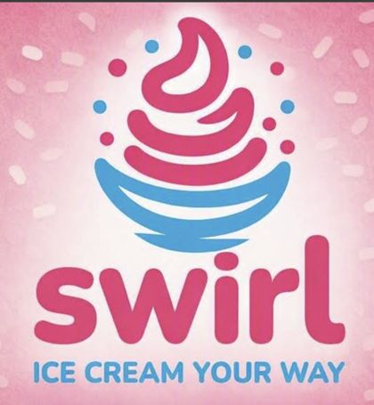

# Swirl

The website for **Swirl**, a frozen yogurt and ice cream shop with a toppings bar on Al Mazoon Street in Seeb, Oman.

**Live site:** https://moenegm.github.io/swirlyourway/



## Features

- One-page, photo-led layout: a hero with the logo, the toppings bar, and a visit section.
- English and Arabic, with a language toggle that remembers the visitor's choice.
- WhatsApp, call, and directions buttons, plus an embedded Google Map.
- Opening hours and address up front.
- Responsive: one column on phones, two on desktop.

## Built with

Plain HTML, CSS, and a little vanilla JavaScript in a single `index.html`. No build step or dependencies. Fonts come from Google Fonts (Baloo Bhaijaan 2 and Readex Pro).

## Run locally

Open `index.html` in a browser, or serve the folder:

```sh
python3 -m http.server
```

## Deploy

Hosted on GitHub Pages from the `main` branch root. `.nojekyll` makes Pages serve the files as they are.

## Built by

[Mohamed A. Negm](https://moenegm.github.io/moenegm/)
